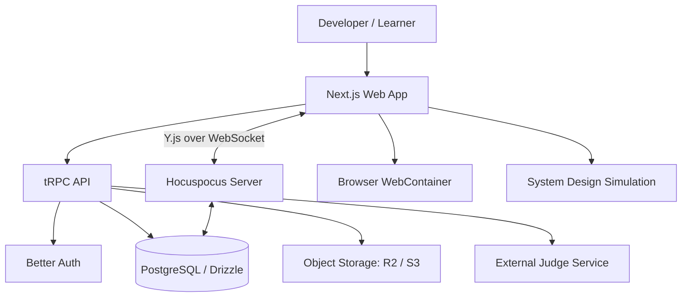
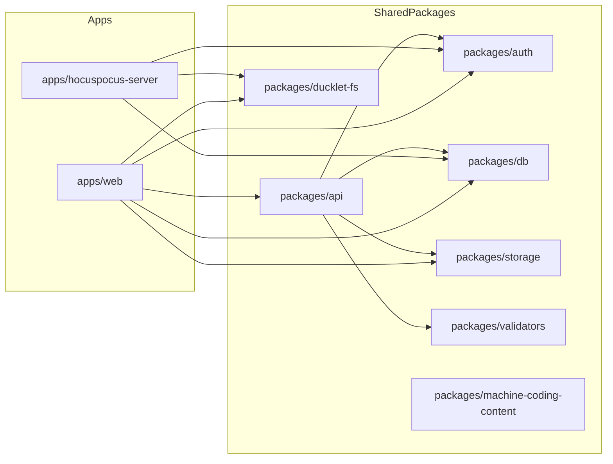

# 🏗️ Coding Bird Architecture

## System context

## Monorepo boundaries

Apps may depend on packages; packages must not depend on apps. Database code and credentials remain server-only. Internal workspace names use `@acme/*`.

## Runtime responsibilities

| Component | Responsibility | Trust boundary |
|---|---|---|
| Browser | UI, local editor runtime, client interactions | Untrusted |
| Next.js app | SSR, route handlers, tRPC mount | Server |
| tRPC/API | Domain procedures, validation, authorization | Server |
| PostgreSQL | Durable relational state and Y.js snapshots | Private infrastructure |
| Hocuspocus | Authenticated Y.js collaboration transport | Separate network service |
| Judge service | Compile/execute user code in isolated workers | Separate execution boundary |
| R2/S3 | Object persistence and delivery | External storage boundary |

These are conceptual architecture guides. Confirm deployment topology, scaling, and firewall rules from infrastructure configuration before operating production.
