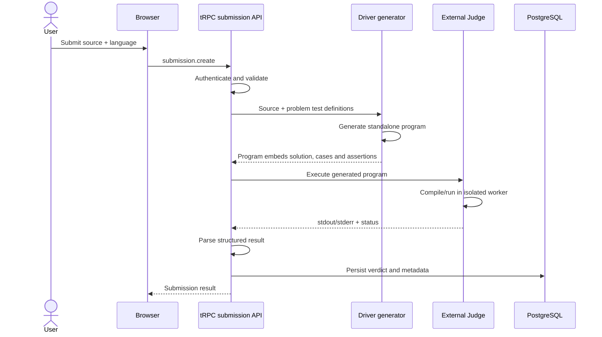

# ⚙️ Code Judging Lifecycle

The API prepares a self-contained driver for a selected language. An external judge executes that driver and returns output. The application parses the result and persists a verdict.

## Invariants

- User code must not execute in the Next.js or tRPC process.
- Test data and expected outputs are embedded into the generated driver, rather than exposed as separately retrievable browser data.
- Judge endpoints and credentials are server-only.
- The judge must enforce time, memory, process, filesystem, and network controls. Driver generation alone does not prove isolation.
- Output parsing treats stdout as untrusted. Malformed or oversized output must fail closed.
- Hidden test cases remain private.

## Language matrix

The README records ten languages: Python, JavaScript, TypeScript, Java, C++, C, Rust, Go, Ruby, and PHP. Implementations live under `packages/api/src/drivers/`. Check the generator and judge image before adding a language or changing compiler flags.

## Change checklist

- [ ] Validate language and problem identifiers.
- [ ] Confirm source-size and submission-rate limits.
- [ ] Test wrapper syntax and escaping.
- [ ] Test empty, malformed, oversized, timeout, compile-error, and runtime-error outputs.
- [ ] Verify hidden tests never reach browser-visible APIs.
- [ ] Verify judge tokens and runner URLs are not logged or bundled.
- [ ] Add regression cases for affected language drivers.
