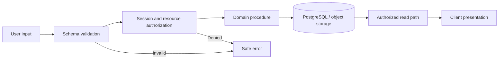

# 🗃️ Data Model and Lifecycle

## Storage boundaries

| Data category | Primary component | Handling requirements |
|---|---|---|
| Identity and sessions | Better Auth + PostgreSQL | Server-side checks; minimize personal data |
| Problems and test definitions | Database/content packages | Keep hidden cases private |
| Submissions and verdicts | API + PostgreSQL | Restrict access and retention |
| Rooms and memberships | Database | Re-check access for every operation |
| Collaborative document state | Y.js + PostgreSQL | Authorize before loading; define recovery |
| Uploaded files/previews | R2/S3-compatible storage | Scoped keys, validation, expiring URLs |
| System-design attempts | PostgreSQL | Validate payload shape and size |
| Browser editor state | Browser storage as implemented | Treat client state as user-controlled |

## Lifecycle

## Data governance

- Collect only data required for product behavior.
- Define deletion and retention for submissions, documents, snapshots, uploads, and audit records.
- Keep private source and hidden test content out of public APIs.
- Do not log secrets, signed tokens, full session data, or source code unless strictly necessary for protected diagnostics.
- Use least-privilege database and storage credentials.
- Verify ownership before issuing presigned URLs.
- Back up relational and object data consistently; test restoration.

## Schema change workflow

1. Update the Drizzle schema.
2. Inspect generated SQL and compatibility.
3. Decide whether rows need a backfill.
4. Apply in a disposable local environment.
5. Test old and migrated data behavior where feasible.
6. Record migration order and rollback limits.
7. Deploy in a compatibility-safe sequence.

The repository documents `pnpm db:push` for local schema application. Do not treat schema push as a production migration/rollback plan.
