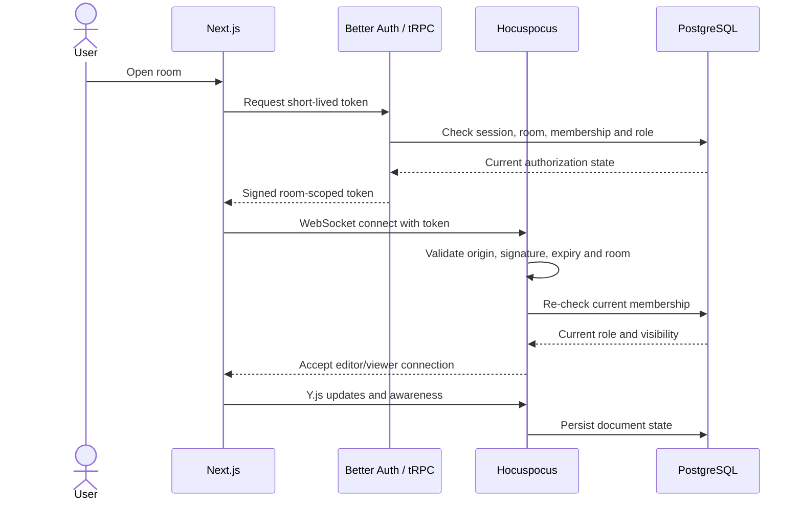

# 🔄 Realtime Collaboration Lifecycle

## Components

The browser uses Y.js documents and the Hocuspocus provider. `apps/hocuspocus-server` handles WebSocket connections and persistence. `packages/auth` verifies signed collaboration tokens, and `packages/db` stores room and membership state.

## Connection and authorization

## Authorization invariants

- Tokens are short-lived and scoped to one resource.
- A token for one room must not authorize another room.
- Revoked access is re-checked at connection time.
- Viewers are read-only at the server protocol layer, not merely disabled in UI.
- Presence identity is derived from verified server context.
- Private source data is not readable through guest/snapshot routes without an explicit safe public-sharing policy.

## Persistence and scaling

The server persists encoded Y.js state to PostgreSQL. Load/store failures must be visible in logs and health signals. Define backup, restore, retention, and recovery objectives before claiming production durability.

An in-process event emitter is single-instance. Horizontal scaling requires shared pub/sub or equivalent coordination for events that must cross instances. Y.js transport and durable state persistence also need deployment-level coordination and failure testing.

## Change checklist

- [ ] Test missing, malformed, expired, revoked, and cross-room tokens.
- [ ] Test private-room membership and public-room access.
- [ ] Test editor and viewer write behavior.
- [ ] Test awareness identity spoofing.
- [ ] Test reconnect, concurrent edits, restart, and persistence errors.
- [ ] Keep tokens and private document data out of logs.
