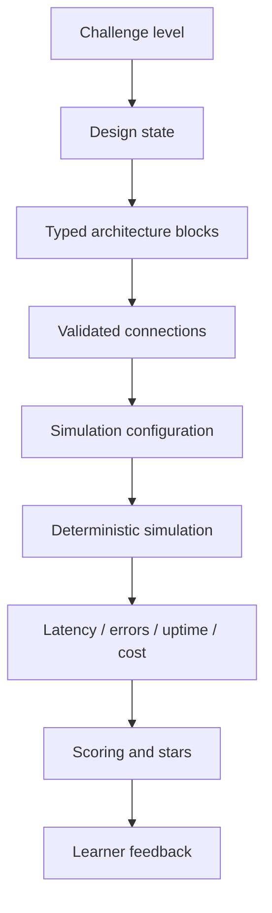

# 🧠 System Design Simulation

The System Design experience lets learners assemble typed architecture blocks and evaluate a design using a deterministic client-side simulation engine. The canvas uses React Flow. Documented scoring dimensions are Reliability, Performance, and Cost Efficiency.

## Conceptual data path

## Correctness constraints

- The same graph, inputs, and engine version should produce the same result.
- Block types and connections are validated before simulation.
- Units are explicit for request rates, payload sizes, latency, capacity, and cost.
- Unsupported topology fails visibly instead of producing plausible metrics.
- Scores explain the trade-offs that drove them.
- Level changes are reflected in the calibration suite.

## Calibration

The repository documents a Node native test suite that checks reference designs against the simulation engine. Keep optimal, naive, and deliberately broken designs in calibration coverage. Do not change thresholds without updating tests and explaining the learning impact.

## Change checklist

- [ ] Add deterministic tests for new engine behavior.
- [ ] Test invalid node and edge combinations.
- [ ] Verify units and boundary values.
- [ ] Update calibration tests and solution documentation.
- [ ] Test scoring explanations against computed metrics.
