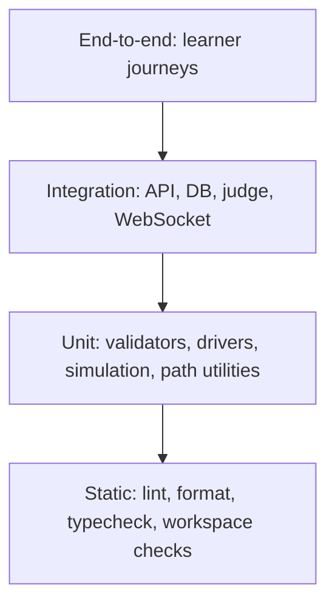

# 🧪 Testing Strategy

## Current documented baseline

The root `AGENTS.md` states that the only dedicated test suite currently present is System Design calibration, invoked with:

```sh
pnpm -F @acme/nextjs test:calibration
```

The root CI workflow currently contains lint, format, and typecheck jobs. Separate workflows add CodeQL analysis and dependency review, while Dependabot checks configured package ecosystems. These are useful checks but do not replace application build, integration, or E2E coverage. Re-check workflow YAML and package scripts after future changes.

## Target test pyramid



This is a target model, not a claim all layers already exist.

## Priority coverage

| Subsystem | High-value tests |
|---|---|
| Auth/API | unauthenticated, unauthorized, role changes, invalid input |
| Database | constraints, transaction boundaries, migration compatibility |
| Judge | every language driver, escaping, compile/runtime failures, limits, malformed output |
| Realtime | invalid/expired/revoked/cross-room tokens, roles, spoofing, reconnect, persistence |
| Ducklet filesystem | traversal attempts, invalid paths, starter template integrity |
| Storage | wrong owner, invalid MIME, oversize, expired URL, cleanup |
| System Design | deterministic outcomes, invalid graph, boundary values, calibration |
| UI | keyboard navigation, focus, mobile layout, loading/error states |

## Evidence rules

Separate automated from manual checks. State when missing dependencies block testing. Never fabricate coverage percentages or test counts. Add regression tests for each confirmed vulnerability.
