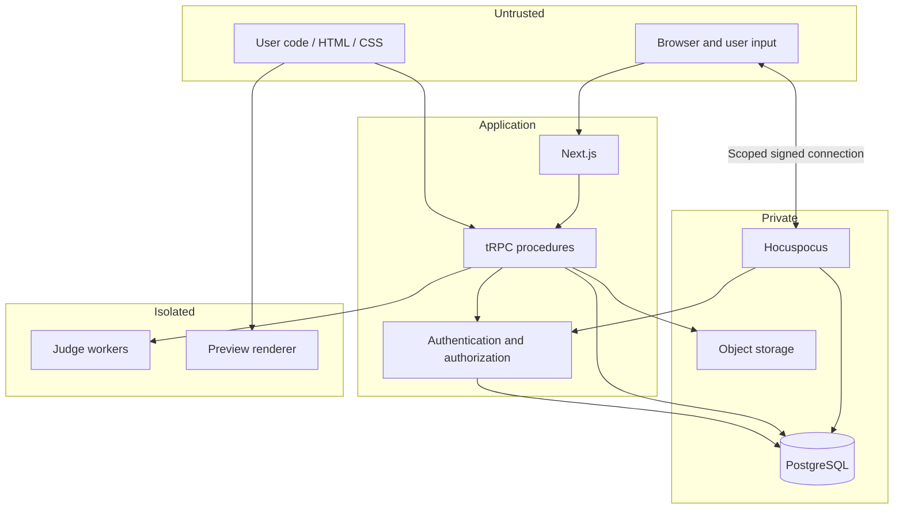

# 🛡️ Security Threat Model

## Assets

User accounts and sessions; private room metadata, membership, source documents and messages; user submissions and hidden tests; storage objects and presigned URLs; database/service credentials; availability and integrity of the judge, web and realtime services.

## Trust boundaries

## Threat register

| Threat | Impact | Required control |
|---|---|---|
| Private room IDOR | Source/message disclosure | Per-resource server authorization |
| Forged/expired token | Impersonation or unauthorized edits | Signed short-lived room-scoped token |
| Awareness spoofing | False identity/presence | Server-derived identity |
| Judge escape/resource exhaustion | Host compromise or outage | Isolated workers and quotas |
| Hidden test leakage | Assessment integrity loss | Keep test data server-side |
| Preview script execution | SSRF/data theft/worker compromise | Browser/container isolation and URL restrictions |
| Storage key manipulation | Cross-user data access | Ownership checks and normalized keys |
| Secret exposure | Service compromise | Secret manager, scanning, rotation, redacted logs |
| Dependency compromise | Supply-chain attack | Lockfile review and dependency auditing |

`DUCKLETS_AUDIT.md` records concrete findings and acceptance criteria. This threat model is a design baseline, not evidence every control is implemented.
